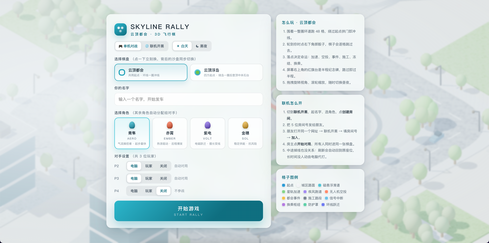
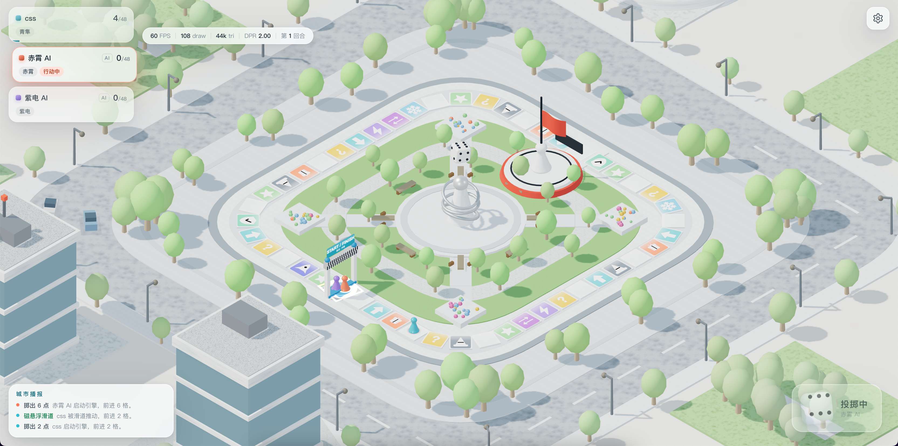
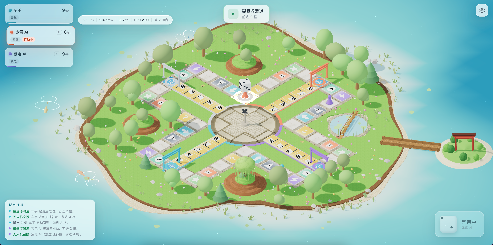
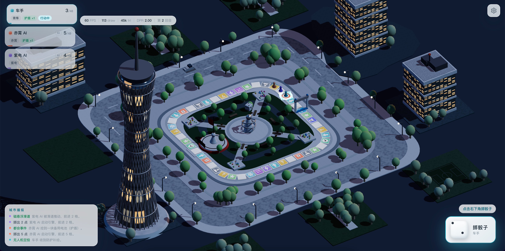

# SKYLINE RALLY · 云顶都会 3D 飞行棋

基于 **Vite + Vue 3 + TypeScript + Three.js** 的 3D 飞行棋对战游戏。所有 3D 模型、材质与贴图均通过代码**程序化生成**，不依赖任何外部模型/图片/字体资源，开箱即可运行。

## 项目简介

在霓虹都市与云端海岛两种主题场景上，与好友或 AI 展开飞行棋对决。支持单机/联机、AI 托管、时段切换、多机位镜头、节奏调节等丰富的可交互体验。

## 效果预览

| 场景一 | 场景二 |
| --- | --- |
|  |  |
| 场景三 | 场景四 |
|  |  |

## 核心特性

- **双主题场景**：城市天际线 / 海岛环礁，几何与材质全部程序化生成。
- **联机对战**：基于云服务的房间系统，支持建房、加入、房间码同步与自动重连。
- **AI 托管**：离线玩家可一键托管给 AI 接管回合。
- **丰富交互**：护盾、冻结等特殊格效果；骰子投掷动画。
- **时段与镜头**：白天/黑夜切换，全景 / 俯瞰 / 平视 / 环绕多种机位。
- **节奏控制**：1× / 2× 快放、音效开关。
- **性能面板**：实时 FPS、draw call、三角面数、DPR 与回合数读数。

## 技术栈

- Vite 8
- Vue 3.5
- TypeScript 5.9
- Three.js 0.186

## 快速开始

```bash
# 安装依赖
npm install

# 启动开发服务器（默认 http://localhost:5288，支持局域网 IP 访问）
npm run dev

# 类型检查 + 构建生产版本
npm run build

# 仅构建（跳过类型检查）
npm run bundle

# 预览构建产物（默认 http://localhost:4173）
npm run preview

# 构建并预览
npm run start
```

> 开发服务器已配置 `host: true`，可在同一局域网下用手机或其他设备通过 `http://<本机内网IP>:5288` 访问。

## 目录结构

```
.
├── screenshot/          # 效果截图
├── src/
│   ├── components/      # Vue 组件（GameCanvas / Hud / Lobby / ResultOverlay）
│   ├── game/            # 游戏逻辑（store / director / engine / theme / sfx）
│   ├── net/             # 联机模块（cloud / room / match / config）
│   ├── three/           # Three.js 场景与渲染（boards / scenes / materials 等）
│   ├── App.vue          # 根组件
│   ├── main.ts          # 入口文件
│   └── style.css        # 全局样式
├── index.html           # HTML 入口
├── vite.config.ts       # Vite 配置
└── tsconfig.json        # TypeScript 配置
```

## 操作说明

- **掷骰子**：点击右下角骰子按钮，当前行动玩家投掷。
- **设置**：点击右上角齿轮图标，可调节时段、镜头、节奏与音效，并重开对局。
- **联机**：在大厅创建或加入房间，分享房间码即可多人同局。
